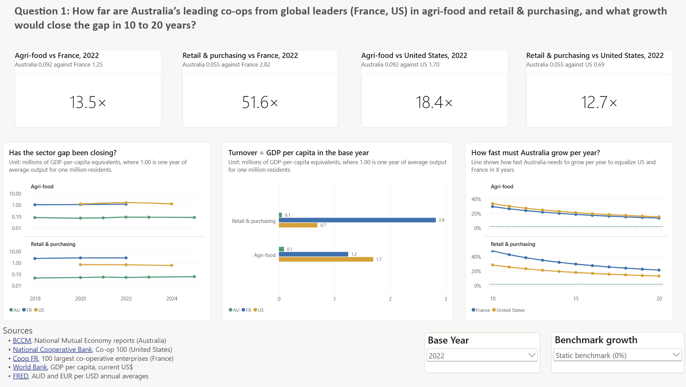
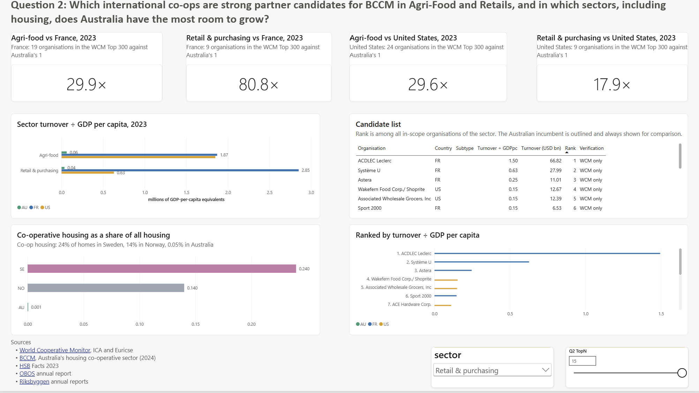
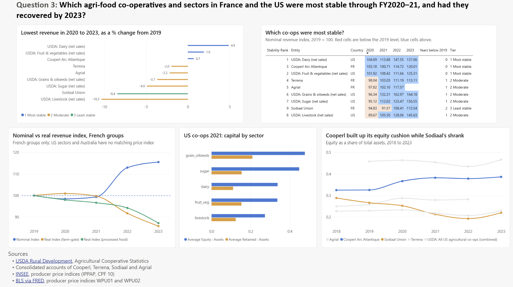

# Persona 1 dashboard: BCCM CEO (Power BI)

Three Power BI pages for the BCCM CEO, who advocates for Australian co-operatives and mutuals and guides BCCM's international strategy. The pages follow one story: **how big is the gap, who could close it with us, and are those partners resilient?**

---

## Page 1: How far is Australia from global leaders?

**Question.** How far are Australia's leading co-ops from global leaders (France, US) in agri-food and retail & purchasing, and what growth would close the gap in 10 to 20 years?

**Problem.** Co-operatives in different economies cannot be compared on raw turnover. The CEO needs a size measure that adjusts for the size of each economy.

**Key findings**
- Turnover is divided by GDP per capita so the three economies sit on one scale. In 2022 Australian agri-food scored 0.092, against 1.25 for France and 1.70 for the US: gaps of **13.5x and 18.4x**.
- In retail and purchasing, Australia scored 0.055 against 2.82 (France) and 0.69 (US): gaps of **51.6x and 12.7x**. The French figure is an upper bound.
- The gap is widest against France in retail and against the US in agri-food, so the partner search differs by sector.
- The line charts (log scale) show Australia's line flat since 2018, so the gap is not closing.
- With the benchmark held at its 2022 level, Australia would need about **29% to 48% growth a year over 10 years** and 14% to 22% over 20 years. Observed growth is about 0.4% a year in agri-food and 4.0% in retail.
- 2022 is the latest year with data for all three countries, because the French series ends there.

**Recommendation.** Make partnerships a core part of BCCM's growth strategy. Organic growth at these rates cannot close the gap, so part of the scale must come from larger co-operatives that already operate at the French and US level. The question shifts from how fast Australia can grow to who it should grow with.

---

## Page 2: Who could be a partner, and where is the room to grow?

**Question.** Which international co-ops are strong partner candidates for BCCM in agri-food and retail, and in which sectors, including housing, does Australia have the most room to grow?

**Problem.** The CEO needs a shortlist of named organisations to approach, and a view of where Australia is least developed.

**Key findings**
- In the World Cooperative Monitor Top 300, France has 19 agri-food and 9 retail organisations and the US has 24 and 9. Australia has 1 in each.
- Sector turnover relative to GDP per capita is about 30x Australia's in agri-food (29.9x France, 29.6x US) and 18x to 81x in retail (17.9x US, 80.8x France).
- Top agri-food candidates: CHS (0.55), In Vivo (0.30), Dairy Farmers of America (0.26), Land O'Lakes (0.20) and Growmark (0.19), each 3 to 9 times larger than CBH (0.06) relative to its economy. In Vivo and Growmark run farm supply and grain marketing like CBH.
- Retail leaders (the page shown): ACDLEC Leclerc (1.50), Système U (0.63) and Astera (0.25). The ranking falls steeply after the first two.
- Co-operative housing holds **24% of homes in Sweden, 14% in Norway and 0.05% in Australia**: the clearest room to grow.
- Every candidate figure is labelled "WCM only", meaning no second source has confirmed it. The ranking is by turnover relative to GDP per capita and is not a judgement of quality.

**Recommendation.** Open due diligence with the top five agri-food organisations, starting with In Vivo and Growmark. In retail, start with Leclerc and Système U after confirming their figures against a second source. Test each partner's capital and recovery (page 3) before any agreement, and treat housing as a growth opportunity.

---

## Page 3: Which partners were stable, and did they recover?

**Question.** Which agri-food co-operatives and sectors in France and the US were most stable through FY2020-21, and had they recovered by 2023?

**Problem.** A large partner is only useful if it can survive a shock. The CEO needs to know who held up, and whether recovery is real or just inflation.

**Key findings**
- Nine entities are compared against their 2019 revenue: four French groups and five US sectors (USDA sector figures, not individual organisations).
- Most stable (never below 2019): US dairy (+4.9% at its lowest), US fruit and vegetables (+1.9%) and Cooperl Arc Atlantique (+0.7%).
- Least stable: Sodiaal Union fell below 2019 in two years (down 8.4% at its lowest). US livestock fell further (-10.3%) but recovered within a year, so tiers rank years below 2019, not depth.
- By 2023 every entity with data was above 2019 in nominal terms.
- Prices rose sharply. For the French groups, 2023 revenue was about 16% above 2019 in nominal terms but **13% to 14% below** after adjusting with INSEE producer price indices, so recovery reflected higher prices, not volume. US sectors and Australia have no matching price index.
- Cooperl's equity rose from 33% to 39% of assets (2018 to 2023) while Sodiaal's fell from 29% to 22%. The group with unbroken revenue also built the thicker cushion.

**Recommendation.** Favour partners that build their capital, and judge recovery after inflation, not in nominal revenue. Cooperl's profile is the one to look for, and Sodiaal's shows the risk. None of the five top candidates from page 2 appears here at organisation level, so apply both tests (capital and inflation-adjusted recovery) directly to each of them.
